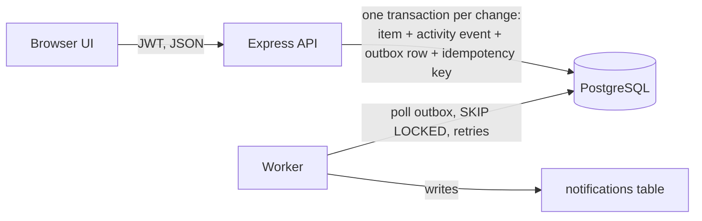

# Ops Board — Newtonite "Operations Under Pressure"

An internal web app where teams create, assign, track and resolve operational work items
(incidents, customer issues, payments, compliance, tasks). Roles are per team, every change is
recorded in an append-only activity log, and the server enforces workflow, permissions and
concurrency rules (the UI only reflects them).

**Stack:** Node.js 22 + TypeScript, Express 5, PostgreSQL 16 (plain SQL via `pg`), zod, JWT auth,
vanilla-JS frontend served by the API, Vitest + Supertest, Docker Compose.

## Run it (one command)

Prerequisite: Docker with Compose.

```bash
docker compose up --build
```

Open http://localhost:3000. On first start the app creates the schema and seeds
4 teams, 10 users and 5,000 work items. A separate `worker` container processes the outbox.

### Demo logins (password for all: `Passw0rd!`)

| Email | Role |
|---|---|
| admin@ops.test | admin in all teams |
| lead.payments@ops.test | lead in Payments Ops, member in Platform |
| lead.support@ops.test | lead in Customer Support |
| lead.compliance@ops.test | lead in Compliance |
| alice@ops.test | member in Payments Ops |
| bob@ops.test | member in Payments Ops and Customer Support |
| carol@ops.test | member in Customer Support |
| dan@ops.test | member in Compliance and Platform |
| eve@ops.test | member in Platform and Payments Ops |
| viewer@ops.test | viewer in Payments Ops and Customer Support |

## Run the tests

```bash
docker compose run --rm app npm test
```

Without Docker: start Postgres, create databases `ops` and `ops_test` (user/password `ops`), copy
`.env.example` to `.env`, then `npm ci && npm run setup && npm test` (`npm start` and
`npm run worker` run the app and the worker). All tests run with one command.

## What is covered by tests (`tests/api.test.ts`)

Concurrent claim (only one wins) · stale update rejected with 409 and data unchanged ·
duplicate / parallel requests with one Idempotency-Key create one item · invalid workflow jumps ·
non-Lead approval and self-approval rejected · other-team users get 404/403 on every read and write ·
history is written atomically and is append-only · pagination, dashboard views and search ·
outbox job processed twice produces one notification · failing job retries with backoff then fails.

## API summary

All endpoints except `/api/login` need `Authorization: Bearer <token>`.

| Method & path | Purpose |
|---|---|
| `POST /api/login` | email + password → token |
| `GET /api/me` | current user, their teams, roles and team members |
| `GET /api/items?view=&status=&priority=&type=&team_id=&assignee=&q=&cursor=&limit=` | filtered, searched, keyset-paginated list |
| `POST /api/items` | create (supports `Idempotency-Key`) |
| `GET /api/items/:id` | detail |
| `PATCH /api/items/:id` | edit with `version` (409 + latest item on conflict) |
| `POST /api/items/:id/claim` | atomic claim (409 if already taken) |
| `POST /api/items/:id/assign` | lead-only (re)assign |
| `POST /api/items/:id/transition` | `{to, version}`, server-enforced workflow |
| `POST /api/items/:id/comments` | add comment |
| `GET /api/items/:id/activity` | history, oldest first, cursor paginated |

`views`: `assigned_to_me`, `unassigned_urgent`, `awaiting_my_approval`.
Errors share one shape: `{ "error": { "code": "version_conflict", "message": "...", ... } }`.

## Domain model (assumptions)

* **Work item:** title, description, type, priority (low/medium/high/urgent), status, team, assignee,
  creator, due date, `version`, timestamps.
* **Roles per team:** viewer < member < lead < admin. Everyone in a team can read its items.
* **Workflow:** `open → in_progress → awaiting_approval → resolved → closed`, plus `in_progress → open`,
  rejection `awaiting_approval → in_progress` and reopen `resolved → open`. Approval, rejection
  and reopen need a Lead (or Admin) of that team. Work cannot start without an owner, and nobody
  can approve their own item.
* **Claiming** assigns an unassigned, non-finished item to the caller (it does not change status).

## Architecture



See `ENGINEERING_DECISIONS.md` for trade-offs and known limitations.
